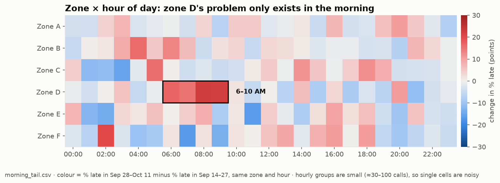

# Zone × hour-of-day heatmap: instructions for B (Saptarshi)

From Kaushik (A, data). Not for merge from this branch: please implement it on `h03-stats`.
It is an extra view, so per Final_Plan section 2 it comes **after the core is deployed**, and the
API field needs a message to C and D first (team notes: field changes need B, C and D).



## What it shows and why

One cell per zone (6 rows) × local hour of the day (24 columns). Colour = **change in % late**:
monitoring period (Sep 28 – Oct 11) minus baseline (Sep 14 – 27), same zone and hour, in
percentage points. Red = worse than its own normal, blue = better, grey = no change.

On `morning_tail.csv`, zone D shows a solid red block from 06:00 to 10:00, a problem the daily
p chart never flags. It pairs with the zone × day view: the daily view finds problems that last
all day, the hourly view finds problems that happen at one time of day.

## 1. Statistic in `app/qc.py`

```python
def late_rate_change_by_hour(df, T=DEFAULT_T, baseline_end=DEFAULT_BASELINE_END):
    """Per zone and local hour (0-23): baseline vs monitoring late rate and the change.

    Descriptive and exploratory: 6 zones x 24 hours = 144 cells, so there is no per-cell flag.
    Returns a list of 144 dicts, ordered by zone_id then hour.
    """
```

Each item:

| Field | Meaning |
|---|---|
| `zone_id`, `hour` | `A`–`F`; 0–23 = local America/New_York hour of `unit_notified_at` |
| `baseline_n`, `baseline_late`, `p_baseline` | baseline calls, late calls (R > T), and their ratio |
| `monitoring_n`, `monitoring_late`, `p_monitoring` | same for the monitoring period |
| `change_pts` | `100 * (p_monitoring - p_baseline)`; `null` if either n is 0 |
| `status` | `ok`, `insufficient_evidence` or `no_data` (rules below) |

Rules (same conventions as `late_rate_by_band`):

- Use `add_timing_components` / `_prepare`, so R, the timezone conversion and the
  baseline/monitoring split are exactly the ones the p chart uses. Late is strictly `R > T`.
- Hour comes from `unit_notified_at` converted to America/New_York **before** taking `.hour`
  (on these dates UTC 10:00 → local 06:00).
- `no_data` if `baseline_n == 0` or `monitoring_n == 0`: rates for the empty side and
  `change_pts` are `null`, never 0.
- `insufficient_evidence` if `baseline_late < 5` or `baseline_n - baseline_late < 5`
  (the plan's minimum of five late and five non-late baseline calls). Keep the rates and
  `change_pts`; only the status changes. The UI greys these cells out.
- Otherwise `ok`.

No new inputs; it works on any uploaded CSV with the agreed columns.

## 2. Tests (`tests/`)

| Test | Input | Expected |
|---|---|---|
| Known answer | zone A, local hour 08: baseline 50 calls with 10 late, monitoring 40 calls with 20 late | `p_baseline` 0.20, `p_monitoring` 0.50, `change_pts` 30.0 (`pytest.approx`), `status` `ok` |
| Too few late in baseline | zone A, hour 08: baseline 10 calls with 2 late, monitoring 10 with 5 late | `change_pts` 30.0, `status` `insufficient_evidence` |
| Empty side | a zone/hour with no monitoring calls | `p_monitoring` and `change_pts` `null`, `status` `no_data` |
| Hour boundaries | notifications at local 05:59:59, 06:00:00 and 23:59:59, plus one given in UTC (`T10:00:00Z` on 2026-10-01) | hours 5, 6, 23 and 6 |
| Shape | any valid CSV | 144 items, ordered A..F then 0..23 |
| Integration, `morning_tail.csv` | real data, T = 12 | see table below |

Integration values on `data/morning_tail.csv` (branch `h02-data`, seed 5300):

| Zone D, hour | Baseline late / n | Monitoring late / n | `change_pts` |
|---|---|---|---|
| 05 | 4 / 30 | 4 / 32 | −0.8 (`insufficient_evidence`) |
| **06** | 9 / 59 | 17 / 53 | **+16.8** |
| **07** | 16 / 81 | 27 / 77 | **+15.3** |
| **08** | 14 / 85 | 30 / 77 | **+22.5** |
| **09** | 11 / 55 | 24 / 57 | **+22.1** |
| 10 | 4 / 66 | 4 / 52 | +1.6 (`insufficient_evidence`) |

Also on `morning_tail.csv`: 44 of the 144 cells are `insufficient_evidence` (fewer than five
late baseline calls), monitoring n per cell ranges 21–113 and baseline n 18–128. Hours 06–09
of zone D are the only planted change, so a good regression test is: the output for
`normal.csv` and `morning_tail.csv` is identical in every cell except zone D, hours 06–09.

## 3. API (needs C and D to agree first)

Proposal: one new field in the existing `GET /zones/summary` response, so no new endpoint:

```json
"hour_heatmap": {
  "metric": "change in % late, monitoring minus baseline (percentage points)",
  "exploratory_note": "144 descriptive comparisons; no per-cell statistical flag",
  "cells": [ { "zone_id": "A", "hour": 0, "baseline_n": "...", "...": "...", "status": "..." } ]
}
```

## 4. How C should draw it

- 6 rows × 24 columns; diverging scale with a **grey midpoint at 0**, blue for better, red for
  worse, symmetric limits (−30 to +30 points), and a colour-bar label in points.
- `insufficient_evidence` and `no_data` cells drawn in flat light grey with a hatch, never
  coloured as 0. A hover shows zone, hour, both rates with their n, and the status.
- Footnote: "Hourly groups are small (about 20–110 calls), so single cells are noisy; look for
  blocks of several adjacent hours."

The preview above was drawn with matplotlib (`imshow` with a `TwoSlopeNorm(0, -30, 30)` and a
blue–grey–red map; light-mode colours `#104281`, `#3987e5`, `#9ec5f4`, `#f0efec`, `#f4a3a2`,
`#e34948`, `#9e2020`). It does not grey out insufficient cells yet; the real version should.

## 5. Caveats to say in the demo and README

- **Exploratory, not a test.** 144 cells, no multiple-comparison correction, no per-cell flag.
  A block of adjacent red hours in one zone is the signal; a single red cell is not.
- It compares the whole monitoring period with the baseline, like the time bands, so a problem
  that was fixed part-way through still shows; use the daily p chart for timing.
- It says when in the day, not why; the stage breakdown is the "why".
